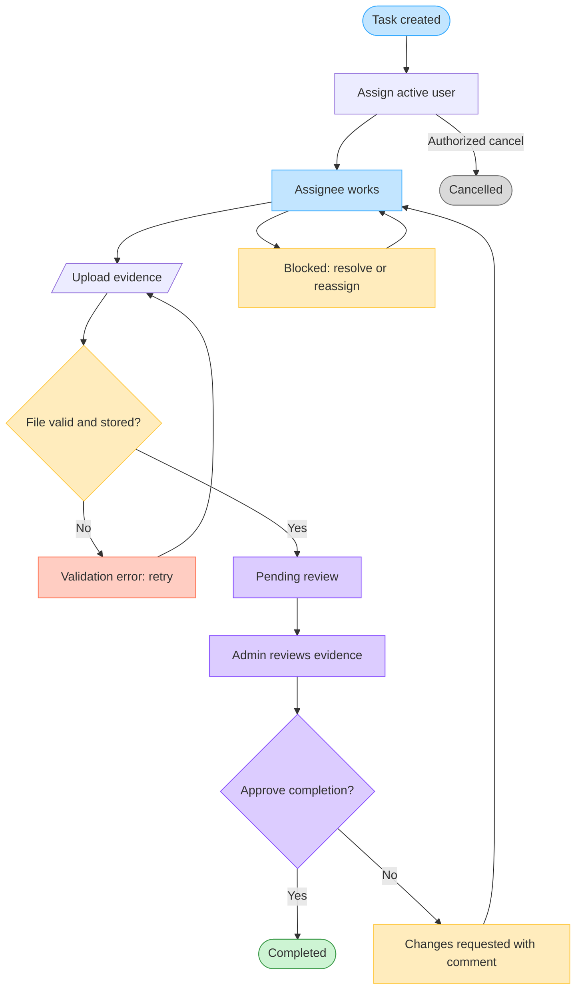

# Task 2: Next Iteration Design

**Internal Task Portal · Nexus AML**

This document proposes the workflow and delivery plan for adding shared task discovery, task details, evidence submission, and administrative approval to the released Part 1 portal.

## Contents

1. [Scope and working assumptions](#1-scope-and-working-assumptions)
2. [Process flow map](#2-process-flow-map)
3. [Proposed solution shape](#3-proposed-solution-shape)
4. [Sprint implementation plan](#4-sprint-implementation-plan)
5. [Dependency sequence and critical path](#5-dependency-sequence-and-critical-path)
6. [Risks and mitigations](#6-risks-and-mitigations)
7. [Definition of done](#7-definition-of-done)

## 1. Scope and working assumptions

- The portal begins as one internal workspace. Every active user can discover shared tasks, while write permissions depend on role and assignment.
- Two roles are sufficient for this iteration: **User** and **Admin**. Admins retain normal user capabilities.
- A task has one assignee at a time. Reassignment is allowed before completion and is recorded in the activity history.
- Only the current assignee can submit or replace evidence. Only an admin can approve or reject it.
- Evidence is stored in a private object store; the relational database stores metadata and object keys, never public URLs or file contents.
- Accepted evidence formats are PDF, PNG, and JPEG, with a configurable 10 MB limit. This should be confirmed with the product owner before implementation.
- Rejection requires an admin comment and returns the task to the assignee. Previous evidence and review decisions remain in the audit history.
- A task becomes **Completed** only through an approved review. Direct status changes to Completed are removed once this workflow is enabled.
- Product decision required: whether an admin may approve their own evidence. The safer default is to prohibit self-approval.

### Proposed task states

- **To do:** Created and assigned, but work has not started.
- **In progress:** The assignee is actively working.
- **Blocked:** Progress cannot continue; a reason is required.
- **Pending review:** Evidence has been submitted and is locked for review.
- **Changes requested:** An admin rejected the submission with feedback.
- **Completed:** An admin approved the evidence.
- **Cancelled:** Work is no longer required; evidence cannot be submitted.

## 2. Process flow map

<!-- PDF_FLOW_DIAGRAM -->

### Workflow rules and alternative paths

1. **Creation and assignment:** A task cannot enter the active queue without an active assignee. If no assignee is selected, it remains in an editable draft-like creation state.
2. **Work and blockers:** The assignee can start work or mark it blocked with a reason. Resolving the blocker or reassigning the task returns it to active work.
3. **Evidence upload:** The server authorizes the upload before issuing a short-lived upload URL. Invalid type, excessive size, failed upload, or failed malware scan leaves the task in its previous state and presents a retry path.
4. **Submission:** Successful submission records immutable evidence metadata and moves the task to Pending review. The assignee cannot edit the submitted file while review is active.
5. **Approval:** Approval and the transition to Completed happen in one database transaction. Repeating the request is safe and does not create duplicate decisions.
6. **Rejection:** A rejection comment is mandatory. The task moves to Changes requested, the assignee can resume work, and a later submission creates a new evidence version.
7. **Cancellation:** An authorized admin can cancel an active task. Pending review and Completed tasks require an explicit policy decision before cancellation or reopening.

## 3. Proposed solution shape

### Data model changes

- Add `role` to User, initially `USER` or `ADMIN`.
- Add `assigneeId`, `createdById`, `status`, and `version` to Task. `version` supports optimistic concurrency for competing edits or reviews.
- Add Evidence with task, uploader, private object key, original filename, MIME type, byte size, checksum, version, and creation timestamp.
- Add Review with evidence, reviewer, decision, optional comment, and decision timestamp.
- Add TaskActivity as an append-only record of assignment and workflow transitions.
- Add indexes for task status, assignee, and the combined status-plus-assignee filter.

### API and authorization boundaries

- `GET /api/tasks?status=&assigneeId=`: Performs server-side, combinable filtering and returns only tasks visible in the current workspace.
- `GET /api/tasks/:taskId`: Returns task, assignee, evidence metadata, review history, and activity permitted to the caller.
- `POST /api/tasks/:taskId/evidence/upload-url`: Authorizes the assignee and returns a short-lived signed upload instruction.
- `POST /api/tasks/:taskId/evidence`: Verifies the uploaded object and submits its metadata for review.
- `POST /api/tasks/:taskId/reviews`: Accepts an admin-only approve or reject decision with an expected task version.
- All authorization is enforced in route handlers or domain services. Hiding a button is never treated as access control.

### File security and operational controls

- Use a private bucket with encryption at rest, blocked public access, narrowly scoped service credentials, and short-lived signed read URLs.
- Validate declared MIME type, detected file signature, extension, size, and checksum. Quarantine uploads until malware scanning succeeds.
- Never accept a client-supplied object key as trusted. Generate keys server-side and bind them to user and task context.
- Record upload, submission, review, reassignment, and completion actions in an append-only audit trail.
- Define retention and deletion requirements with compliance before release; completion evidence may be subject to longer retention than ordinary task data.

## 4. Sprint implementation plan

### Delivery assumptions

- Two-week sprints with two full-stack engineers and shared QA/product support.
- Part 1 is deployed and its authentication, task CRUD, and migration pipeline are stable.
- The team has access to a non-production private object-storage bucket and a malware-scanning service or agreed substitute.
- Story points indicate relative complexity, not elapsed time. Capacity should be adjusted after team estimation.

### Sprint 1: Shared work, assignment, and task details

**Goal:** Users can discover relevant shared work, filter it, assign it, and open a secure task details screen.

#### T2-01: Define roles and authorization policy (3 points)

**Dependencies**

- None.

**Implementation**

- Add User and Admin roles with a centralized permission matrix.
- Seed or document a safe first-admin mechanism.
- Add route-level authorization tests for user, assignee, creator, admin, and unauthenticated callers.

**Acceptance criteria**

- Permissions are defined once and reused by pages and APIs.
- Unauthenticated requests return 401; authenticated but forbidden requests return 403.
- A user cannot gain admin capability by changing request payloads or route parameters.

#### T2-02: Extend task and assignment schema (5 points)

**Dependencies**

- T2-01 policy decisions.

**Implementation**

- Add assignee, creator, expanded status, and optimistic version fields through a reviewed Prisma migration.
- Backfill existing Part 1 tasks to their creator as assignee and preserve current status where possible.
- Add indexes for status, assignee, and combined filters.

**Acceptance criteria**

- Migration applies to a representative copy of production data and has a documented rollback or forward-fix plan.
- Existing tasks remain accessible after migration.
- Invalid state and assignment values are rejected by validation and the domain service.

#### T2-03: Add assignment workflow (3 points)

**Dependencies**

- T2-01 and T2-02.

**Implementation**

- Add active-user lookup and assignee selection to task create/edit flows.
- Record assignment and reassignment in TaskActivity.
- Prevent assignment to disabled or unknown users.

**Acceptance criteria**

- Authorized users can assign or reassign a task to one active user.
- Reassignment is visible on the task and in its activity history.
- Unauthorized assignment attempts do not modify data.

#### T2-04: Implement server-side task filtering (5 points)

**Dependencies**

- T2-02.

**Implementation**

- Add status and assignee query parameters to the task API and repository.
- Add filter controls whose state is represented in the URL for refresh and sharing.
- Define loading, empty, invalid-filter, and clear-filter behavior.

**Acceptance criteria**

- Status and assignee filters work independently and together.
- Refreshing or sharing the URL preserves the selected filters.
- Filtering is performed in the database, not on an already-truncated client list.
- Invalid filter values produce a controlled 400 response.

#### T2-05: Build the task details screen (5 points)

**Dependencies**

- T2-02 and T2-03.

**Implementation**

- Add `/tasks/[taskId]` with task data, assignee, status, evidence area, and activity timeline placeholders.
- Link list rows to the details route and preserve filter context on return.
- Add not-found and forbidden states without leaking whether an inaccessible task exists.

**Acceptance criteria**

- Selecting a task opens a dedicated, directly addressable details page.
- The page is server-authorized and renders the latest task version.
- Keyboard navigation, focus states, headings, and breadcrumbs meet the existing accessibility standard.

#### Sprint 1 quality and release work (5 points)

**Dependencies**

- T2-01 through T2-05.

**Implementation**

- Add repository, API integration, and browser tests for assignment, filters, and details.
- Review query plans and pagination behavior with representative task volume.
- Release behind a feature flag and monitor authorization failures and API latency.

**Sprint 1 exit criteria**

- Product accepts assignment, combined filtering, and task-details journeys.
- Security tests pass for all defined roles.
- Migration and rollback rehearsal completes in staging.

### Sprint 2: Evidence submission and admin approval

**Goal:** An assignee can submit secure evidence and an admin can approve or reject completion with a complete audit history.

#### T2-06: Provision private evidence storage (5 points)

**Dependencies**

- Approved file policy and infrastructure access.

**Implementation**

- Configure private storage, encryption, lifecycle rules, CORS, service identity, and environment configuration.
- Integrate malware scanning or define a quarantine-and-release mechanism.
- Add operational documentation for failed scans and orphaned uploads.

**Acceptance criteria**

- Objects cannot be listed or fetched publicly.
- Upload and download permissions expire quickly and are scoped to one object.
- A failed scan cannot be submitted for review.

#### T2-07: Implement authorized evidence upload (5 points)

**Dependencies**

- T2-01, T2-05, and T2-06.

**Implementation**

- Add upload authorization and completion endpoints.
- Validate size, type, signature, checksum, task state, and current assignee.
- Show progress, retry, cancel, and validation errors on the details screen.

**Acceptance criteria**

- Only the current assignee can upload evidence for an eligible task.
- Invalid or oversized files are rejected without creating usable evidence records.
- Refreshing after a successful upload shows the same evidence metadata.

#### T2-08: Add submission and workflow transitions (5 points)

**Dependencies**

- T2-02 and T2-07.

**Implementation**

- Implement allowed state transitions in a domain service rather than directly in UI handlers.
- Submit verified evidence and transition to Pending review transactionally.
- Support a new evidence version after Changes requested while retaining earlier versions.

**Acceptance criteria**

- A task without verified evidence cannot enter Pending review.
- Submitted evidence cannot be silently overwritten during review.
- Concurrent stale updates receive a conflict response and do not overwrite newer work.

#### T2-09: Build admin review queue and decision flow (8 points)

**Dependencies**

- T2-01, T2-05, and T2-08.

**Implementation**

- Add an admin-only Pending review queue and evidence viewer/download action.
- Implement approval and rejection; require a comment for rejection.
- Complete approval, Review creation, TaskActivity creation, and status transition in one transaction.

**Acceptance criteria**

- Non-admin callers receive 403 from every review endpoint.
- Approval is idempotent and is the only normal route to Completed.
- Rejection returns the task to Changes requested with visible feedback.
- The UI prevents double submission and handles version conflicts clearly.

#### T2-10: Complete audit, notifications, and observability (3 points)

**Dependencies**

- T2-03, T2-08, and T2-09.

**Implementation**

- Present a chronological activity timeline for assignment, submission, and review.
- Add in-app notifications for assignment, rejection, and approval; external email is a follow-up unless requested.
- Add structured logs and metrics for upload failures, scan failures, review outcomes, and authorization denials.

**Acceptance criteria**

- Every workflow transition records actor, timestamp, prior state, and new state.
- Review comments and evidence versions remain traceable.
- Support staff can correlate a failed UI action with a server request without exposing sensitive file data in logs.

#### T2-11: Security, accessibility, and release validation (5 points)

**Dependencies**

- T2-06 through T2-10.

**Implementation**

- Add end-to-end happy paths and rejection/resubmission paths.
- Test horizontal access attempts, malicious files, expired links, repeated decisions, and concurrent review.
- Complete accessibility review for filters, upload progress, dialogs, evidence links, and decision feedback.
- Rehearse migration, storage configuration, feature-flag rollout, and rollback in staging.

**Acceptance criteria**

- Critical workflows pass in supported browsers and keyboard-only navigation.
- No uploaded object is public and no signed URL is persisted or logged.
- Product, engineering, QA, and security owners approve the release checklist.

**Sprint 2 exit criteria**

- The end-to-end create-to-approval flow is accepted in staging.
- Audit records reconcile with all tested state transitions.
- Dashboards, alerts, support notes, and rollback steps are ready before enabling the feature flag.

## 5. Dependency sequence and critical path

1. Confirm roles, assignment rules, file policy, retention, and self-approval policy.
2. Apply the task and authorization data migration.
3. Deliver assignment, filtering, and the details route.
4. Provision private storage and malware scanning in parallel with the details UI.
5. Implement upload authorization before submission transitions.
6. Implement submission transitions before admin review actions.
7. Add the audit timeline and full end-to-end tests before release.

The critical path is **authorization policy → schema migration → task details → storage → evidence submission → admin decision → release validation**. UI work can proceed against typed fixtures, but no workflow should ship before server-side authorization and state-transition rules are complete.

## 6. Risks and mitigations

- **Sensitive evidence exposure:** private storage, short-lived signed URLs, least-privilege credentials, and explicit security tests.
- **Unsafe file content:** signature validation, quarantine, malware scanning, and no inline rendering of untrusted formats.
- **Conflicting updates:** task version checks and transactional review decisions.
- **Authorization drift:** one permission matrix, negative integration tests, and no client-only enforcement.
- **Migration regression:** backfill rehearsal with production-like data and staged rollout behind a feature flag.
- **Unbounded storage:** file limits, lifecycle rules, orphan cleanup, retention policy, and storage monitoring.
- **Workflow ambiguity:** confirm cancellation, reopening, reassignment, self-approval, and retention decisions before Sprint 2 development begins.

## 7. Definition of done

- Acceptance criteria and automated tests pass in CI.
- Prisma migrations are reviewed, repeatable, and verified in staging.
- Authorization is enforced and negatively tested at every API boundary.
- Evidence storage is private, scanned, encrypted, and covered by retention rules.
- Accessibility checks pass for keyboard navigation, focus management, status feedback, and upload progress.
- Logs, metrics, dashboards, feature flags, rollback steps, and support notes are ready.
- README and API documentation reflect the released workflow and operational requirements.
